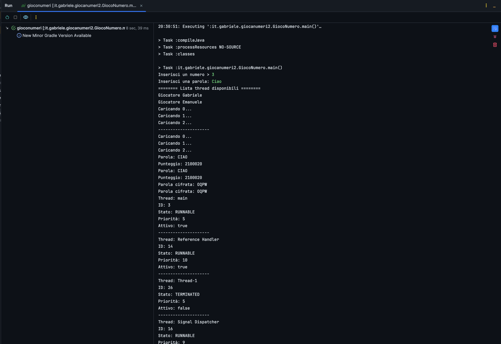

# GiocoNumeri

Un semplice gioco che prende legge in ingresso un numero, una parola e avvia due thread.

Nella versione 2 è possibile vedere anche i thread attivi e cifrare la parola scelta usando Vigenere.

